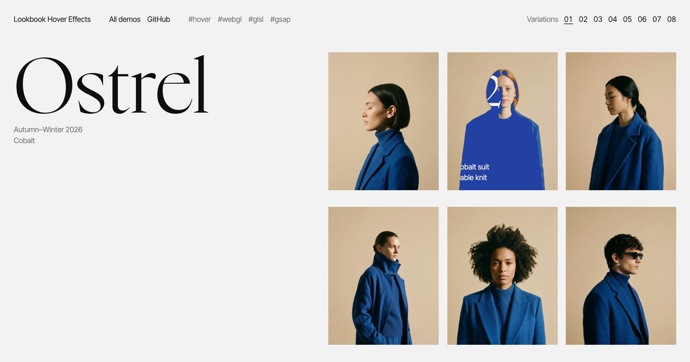

# Lookbook Hover Effects

Eight hover effects for a lookbook grid of photographs: a card takes over each one, never with a plain straight wipe: along a jagged, curved or folded edge, melting through, seen through glass or flickering in like a changing channel. Driven by [GSAP](https://gsap.com), and drawn in WebGL in every variation but 03, which cuts the card with a CSS `clip-path`.

Inspired by the jagged-edge wipe of the menu on [Monument](https://monument.tv/). 03 is based on it; the other seven are our own takes on the same idea, a card taking over a photograph some other way than a plain wipe.



[Demo](https://tympanus.net/Demos/LookbookHoverEffects/)

## Installation

Run this demo on a [local server](https://developer.mozilla.org/en-US/docs/Learn/Common_questions/Tools_and_setup/set_up_a_local_testing_server). There's no build step and nothing to install, but the scripts are ES modules, which don't load from `file://`:

```sh
npx serve .
# or
python3 -m http.server
```

Then open `index.html` (or `index2.html` … `index8.html` for the other variations) and move the pointer over the photographs. On a touch screen, tap one to bring its card in and tap again to send it off.

## Credits

- Inspired by the menu transition on [Monument](https://monument.tv/); 03 is based on it.
- Photographs: generated for this demo with Nano Banana in [Paper](https://paper.design), a series of six for each variation.
- Nyght Serif by Maksym Kobuzan (SIL Open Font License, `fonts/OFL.txt`), and [Inter Tight](https://fonts.google.com/specimen/Inter+Tight) from Google Fonts.
- [GSAP](https://gsap.com) 3.15.

## Misc

Follow Codrops: [Bluesky](https://bsky.app/profile/codrops.bsky.social), [Facebook](https://www.facebook.com/codrops), [GitHub](https://github.com/codrops), [Instagram](https://www.instagram.com/codropsss/), [X](https://www.x.com/codrops)

## License

The code is [MIT](LICENSE). Nyght Serif in `fonts/` is under the SIL Open Font License (`fonts/OFL.txt`), and GSAP in `js/gsap.min.js` under its own [standard license](https://gsap.com/standard-license).
